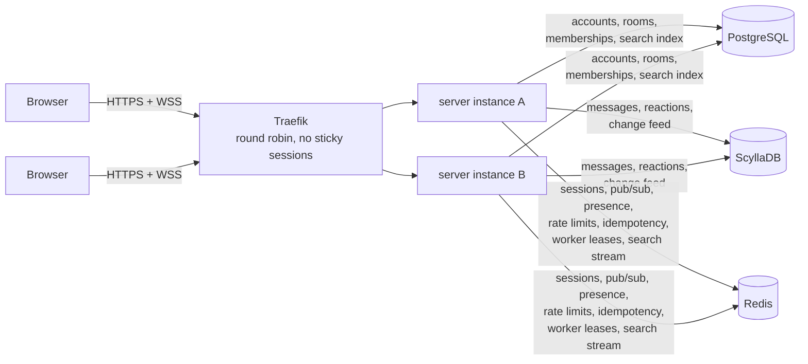
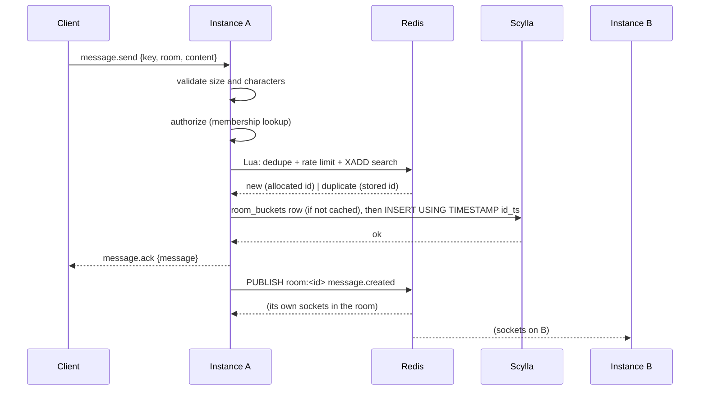

# Design

Status: approved 2026-11-04. Every recommendation in section 17 was accepted.
Decision 14 stays open until the Phase 4 load test measures it.

This document is the plan for v1. It covers the architecture, the three data
models, the protocol, the write, fan-out and reconnect paths, auth, abuse
controls, search, unread counts, deployment and testing. Section 16 answers
the subtle cases directly. Section 17 lists the decisions I need you to make.
Section 18 lists claims I still have to verify against real software in
Phase 1.

Numbers in this document are design limits (timeouts, caps, sizes) unless a
line says otherwise. No performance number appears here, because none has been
measured yet.

---

## 1. Scope

v1 builds: password, GitHub and guest accounts; public rooms, private rooms
(invite links), DMs; owner/member roles; real-time messaging with history,
resume, presence, typing, read receipts, unread counts, edit, delete,
reactions and search.

Out of scope, listed as future work in the README: file uploads, voice and
video, push notifications, end-to-end encryption, federation, mobile apps,
email verification and password reset (decided in Phase 0), an admin UI,
backups (decided in Phase 0).

---

## 2. Architecture



Every instance runs the same binary with the same configuration. An instance
holds only per-connection state in memory (its sockets and which rooms they
are routed for). Everything that must survive an instance dying lives in one
of the three stores.

The binary has three subcommands:

- `server serve` runs the HTTP API, the WebSocket gateway, the fan-out
  subscriber, a search-indexer worker and the scheduled jobs.
- `server migrate` applies Postgres and Scylla migrations, then exits.
- `server healthcheck` makes a GET request to `/readyz`, for the Docker
  healthcheck, so the runtime image needs no curl.

Running the indexer and jobs inside every instance avoids a third service
type. Indexing is shared through a Redis Stream consumer group, so each entry
goes to one instance. Scheduled jobs (guest cleanup, demo reset, presence
sweep) take a Redis lock first (`SET lock:job:<name> <instance> NX PX`), so
only one instance runs each job.

The built React app is served by the Rust server (tower-http `ServeDir`), so
the SPA, `/api` and `/ws` share one origin. That keeps cookies first-party and
the Origin check exact, and there is one deployable image.

Ports: `8080` serves the app, the API and `/ws`, and goes through the load
balancer. `9090` serves `/metrics` on the internal network only, so metrics
are never public.

---

## 3. Identifiers

### 3.1 Message IDs

Message IDs are 64-bit, Snowflake-style, and stored as a signed `bigint`
everywhere (the top bit is always 0):

| bits | field | range |
|---|---|---|
| 41 | milliseconds since 2026-01-01T00:00:00Z | until about 2095 |
| 10 | worker ID | 0 to 1023 |
| 12 | sequence within the millisecond | 0 to 4095 |

IDs sort by creation time, so the clustering order in Scylla is time order. An
ID also tells you its bucket (section 4.2), so a message can be found from
`(room_id, message_id)` alone, without a secondary index.

If the sequence wraps, the generator waits for the next millisecond. If the
clock moves backwards, the generator waits when the step is 10 ms or less,
and refuses to issue IDs otherwise (sends return `unavailable`).

In JSON, IDs are strings. JavaScript numbers lose precision above 2^53, and a
Snowflake ID is larger than that.

Rooms, users and sessions use UUIDv7, generated in Rust: time-ordered for
B-tree locality, no coordination needed.

### 3.2 Worker IDs without collisions

Scylla `INSERT` is an upsert. Two messages with the same `(room, id)` would
silently overwrite each other, so worker IDs must never be shared. They are
leased from Redis:

1. **Acquire.** At startup the instance tries
   `SET worker:<n> <instance_uuid> NX PX 15000` for n from a random start,
   wrapping through 0 to 1023, until one succeeds.
2. **Quarantine.** It waits one full lease period (15 s) before issuing IDs,
   renewing the lease meanwhile (step 3).
   If Redis lost the key (a restart without persistence) while an old holder
   was still running, the old holder notices at its next renewal (step 3) and
   stops before the new holder starts. `/readyz` is false during quarantine,
   so the load balancer sends no traffic.
3. **Renew** every 5 s with a Lua script that extends the TTL only if the
   value is still this instance's UUID. If the value belongs to someone else,
   the instance stops issuing IDs immediately and re-acquires.
4. **Fence locally.** The instance treats its lease as valid only until
   `time_renewal_was_sent + 15 s - 1 s`, measured on the monotonic clock. If
   Redis is unreachable, it stops issuing IDs before Redis can expire the key
   and hand it to someone else. Redis starts its own 15 s countdown after
   receiving the request, so the local deadline always comes first.
5. **High-water mark.** Each renewal also writes `worker_hwm:<n>` (the last
   millisecond used). A new holder starts at `max(now, hwm + 1)`, so even a
   clock behind the previous holder's cannot repeat its IDs.
6. **Release.** On graceful shutdown the instance deletes its key, through
   the same compare-and-delete script.

Scaling up takes any free number. Scaling down releases one. A crash frees it
after 15 s.

### 3.3 Clock bound

Resume correctness (section 16.1) needs a bound on clock skew between
instances. At each lease renewal, the instance compares its clock with Redis
`TIME`, corrected by half the round trip. If the difference is over 500 ms, it
stops issuing IDs and reports not ready until the clocks agree again. Redis is
the reference clock, so any two instances that are issuing IDs are within
1 s of each other.

---

## 4. Data model

### 4.1 PostgreSQL (sqlx, migrations, compile-time-checked queries)

```sql
users (
  id             uuid primary key,
  handle         text not null,               -- unique lower(handle), [a-z0-9_]{3,32}
  display_name   text not null,
  email          text,                        -- unique lower(email) where not null
  password_hash  text,                        -- Argon2id PHC string
  github_id      bigint unique,
  avatar_url     text,
  is_guest       boolean not null default false,
  created_at     timestamptz not null,
  expires_at     timestamptz,                 -- set only for guests
  banned_at      timestamptz,                 -- set by the admin command (11.4)
  check (is_guest = (expires_at is not null)),
  check (not is_guest or (email is null and github_id is null)),
  check (password_hash is null or email is not null)
)

sessions (                                    -- metadata; the hot copy is in Redis
  id            uuid primary key,
  user_id       uuid not null references users on delete cascade,
  token_hash    bytea not null unique,        -- SHA-256 of the cookie token
  created_at    timestamptz not null,
  last_seen_at  timestamptz not null,
  expires_at    timestamptz not null,
  user_agent    text,
  ip            inet,
  revoked_at    timestamptz
)  index (user_id) where revoked_at is null

rooms (
  id                  uuid primary key,
  kind                room_kind not null,     -- 'public' | 'private' | 'dm'
  name                text,                   -- null for DMs
  created_by          uuid references users on delete set null,
  created_at          timestamptz not null,
  is_demo             boolean not null default false,
  dm_key              text unique,            -- 'lowuuid:highuuid', DMs only
  message_expiry_at   timestamptz,            -- see 11.3
  history_floor       bigint not null default 0,  -- lowest visible message ID
  check ((kind = 'dm') = (dm_key is not null))
)

memberships (
  room_id       uuid references rooms on delete cascade,
  user_id       uuid references users on delete cascade,
  role          member_role not null,         -- 'owner' | 'member'
  joined_at     timestamptz not null,
  last_read_id  bigint not null default 0,
  primary key (room_id, user_id)
)  index (user_id), index (room_id, last_read_id)

invites (
  code        text primary key,               -- 128-bit random, base64url
  room_id     uuid not null references rooms on delete cascade,
  created_by  uuid references users on delete set null,
  expires_at  timestamptz not null,
  max_uses    int not null,
  uses        int not null default 0
)

message_search (                              -- section 10
  message_id  bigint primary key,
  room_id     uuid not null,
  author_id   uuid not null,
  tsv         tsvector not null,
  deleted     boolean not null default false,
  version     bigint not null,
  expires_at  timestamptz
)  gin (tsv), index (room_id, message_id)
```

The queries each table serves:

| Query | Served by |
|---|---|
| Login by email, GitHub callback by `github_id` | unique indexes on `users` |
| List and revoke my sessions | `sessions (user_id)` partial index |
| My rooms with role and `last_read_id` | `memberships (user_id)` |
| Is U a member of R, and with which role (every frame) | `memberships` primary key |
| Find or create the DM between A and B | `rooms.dm_key` unique |
| "Seen by N" for a message | `memberships (room_id, last_read_id)` |
| Search within my rooms | `message_search` GIN, joined to `memberships` |
| Expired guests and expired DM rooms | sequential scan in a 1-minute job, fine at this size; add a partial index if measured slow |

The DM `dm_key` unique constraint makes "one DM per pair" a database
guarantee, not an application check. In the migrations, `room_kind` and
`member_role` are `text` columns with CHECK constraints rather than Postgres
enum types, which keeps sqlx's compile-time checking simple; a unique
partial index enforces one owner per room. Rule: owners cannot leave their room.
They can delete it (ownership transfer is future work).

### 4.2 ScyllaDB

Keyspace `chat`, `NetworkTopologyStrategy` with replication factor 1 in both
dev and prod (a single node; see 14.3). We use no LWT, counters, materialized
views or secondary indexes, so the default tablets mode works.

```sql
CREATE TABLE messages (
  room_id     uuid,
  bucket      int,          -- hours since the ID epoch, from the message ID
  message_id  bigint,
  author_id   uuid,
  content     text,
  edited_at   timestamp,
  deleted     boolean,
  version     bigint,       -- write timestamp (µs) of the latest state change
  PRIMARY KEY ((room_id, bucket), message_id)
) WITH CLUSTERING ORDER BY (message_id DESC);

CREATE TABLE room_buckets (       -- non-empty buckets per room
  room_id  uuid,
  bucket   int,
  PRIMARY KEY (room_id, bucket)
) WITH CLUSTERING ORDER BY (bucket DESC);

CREATE TABLE reactions (
  room_id     uuid,
  bucket      int,
  message_id  bigint,
  emoji       text,
  user_id     uuid,
  active      boolean,     -- soft toggle, never a row delete
  PRIMARY KEY ((room_id, bucket), message_id, emoji, user_id)
);

CREATE TABLE room_changes (       -- edits, deletes and reactions, for resume
  room_id     uuid,
  day         int,          -- days since the ID epoch, from change_id
  change_id   bigint,       -- Snowflake ID allocated at change time
  message_id  bigint,
  kind        tinyint,      -- 1 edit, 2 delete, 3 reaction
  PRIMARY KEY ((room_id, day), change_id)
) WITH default_time_to_live = 604800      -- 7 days
  AND compaction = {'class': 'TimeWindowCompactionStrategy', ...};
```

| Query | CQL shape |
|---|---|
| History page, newest first | `messages WHERE room_id=? AND bucket=? AND message_id<? LIMIT n` |
| Next older non-empty bucket | `room_buckets WHERE room_id=? AND bucket<? LIMIT 16` |
| New messages since a cursor | `messages WHERE ... AND message_id>? ORDER BY message_id ASC` |
| One message, for edit, delete or hydrating a search result | `messages WHERE room_id=? AND bucket=? AND message_id=?` |
| Reactions for one page | `reactions WHERE room_id=? AND bucket=? AND message_id>=? AND message_id<=?` |
| Changes since a cursor | `room_changes WHERE room_id=? AND day=? AND change_id>?`, at most 8 days |

**Why one-hour buckets.** A bucket bounds a partition's size. The per-room
rate limit (11.1: 10 messages a second sustained) caps an hourly partition at
36,000 rows, which is at most about 150 MB even if every message were the
4 KiB maximum. A one-day bucket under the same limit allows 864,000 rows. The
cost of small buckets is that quiet rooms have many empty hours.
`room_buckets` removes that cost: pagination jumps straight to the next
non-empty bucket instead of probing every hour. One more write per message
pays for this, and an in-process cache of "buckets this instance has already
recorded" makes it about one write per room per hour per instance. The
alternative (one-day buckets, probe every day back to the room's creation, no
index) is listed in section 17.

**Order of writes.** The `room_buckets` row is written before the message. If
the message write then fails, the bucket is merely empty, and pagination
handles empty buckets anyway. The reverse order could hide a committed
message from pagination.

**Pagination (backwards).** The cursor is a message ID, and the bucket comes
from the ID.

```
page(room, before_id, limit):
  floor  = rooms.history_floor
  bucket = bucket_of(before_id); upper = before_id
  out = []
  scanned = 0
  loop:
    out += messages in (room, bucket) with floor < id < upper, newest first,
           limit (limit - len(out))
    scanned += 1
    if len(out) == limit:          return out, next_cursor = last id
    bucket = next older entry in room_buckets with bucket >= bucket_of(floor)
    if none:                       return out, next_cursor = null   # start of room
    if scanned == 32:              return out, next_cursor = last id or bucket boundary
    upper = +infinity
```

The loop handles empty buckets, whether never written or written and then
expired by TTL, by moving on. It stops when `room_buckets` has no older entry
(that is the room's first bucket) or when it reaches `history_floor`. Each
request does bounded work (at most 32 partitions). A partial page returns a
cursor, and the client asks again. The bucket math and this loop are pure
functions over a storage trait, unit-tested with fixtures that have empty and
expired buckets.

**Soft delete.** A user delete sets `deleted = true`, `content = ''` and
`version`. It writes cell values, not tombstones (setting a column to `null`
in CQL writes a tombstone, so content is cleared to an empty string). Row
deletes would leave tombstones in the hottest partitions: every read of
recent history would scan past them until compaction purges them after
`gc_grace_seconds` (10 days by default), and many deletes in one partition can
make reads slow or fail. The cost of soft delete is that the row and its
metadata (author, time) remain, and readers must mask deleted rows. The
storage layer never returns content for a deleted row. The UI shows
"message deleted", which also keeps pagination stable. Old content still
exists in older SSTables until compaction rewrites them. It cannot be read
through the system, but it is not physically erased the moment the user
deletes. The README will say so.

Reactions use the same idea: removing a reaction sets `active = false`, it
does not delete the row.

**Write timestamps.** Every Scylla write sets `USING TIMESTAMP` explicitly:

- The insert uses the timestamp encoded in the message ID. Every retry of
  the same insert carries the same timestamp.
- Edits and deletes use `max(now_µs, previous_version + 1)`.

Scylla resolves each cell by last write wins on that timestamp. So an insert
replayed by a retry (16.3) can never overwrite a later edit or delete, in
whatever order the writes arrive. `version` is the same timestamp, and
clients use it to order the updates they receive (16.5).

### 4.3 Redis

Redis 8, with AOF persistence (`appendfsync everysec`) and
`maxmemory-policy noeviction`. Sessions, leases and idempotency keys must
never be evicted to make room.

| Key or channel | Type | TTL | Purpose |
|---|---|---|---|
| `sess:<sha256(token)>` | hash `{user_id, session_id, expires_at}` | session lifetime | session lookup |
| `idem:<user>:<key>` | string `msg_id:room_id:content_hash` | 24 h | send dedupe |
| `rl:<scope>:<id>` | hash `{tokens, ts}` | until full | token buckets |
| `presence:<user>` | hash `conn_id -> active\|idle`, per-field `HEXPIRE` | 75 s per field | live connections |
| `presence_status:<user>` | string | none, cleared by the sweeper | last published status |
| `presence_online` | set | none | users the sweeper checks |
| `worker:<n>`, `worker_hwm:<n>` | string | 15 s / 1 h | ID leases (3.2) |
| `oauth:<state>` | hash `{verifier, nonce}` | 10 min | GitHub login |
| `lock:job:<name>` | string | job length | single-runner jobs |
| `search:events` | stream, `MAXLEN ~ 1000000` | | indexer queue |
| `room:<room_id>` | pub/sub channel | | messages, edits, typing, membership events |
| `user:<user_id>` | pub/sub channel | | session revoked, joined or removed, guest expired |
| `presence` | pub/sub channel | | presence transitions, system-wide |

**Pub/sub semantics.** A message is delivered only to connections that are
subscribed at the moment it is published. Nothing is stored or replayed, and
a subscriber that is disconnected misses it. That is why pub/sub is only the
fast path and Scylla is the source of truth. Redis processes `PUBLISH`
commands one at a time, so all subscribers see one total order on a given
channel, even when different instances publish to it (16.4 relies on this).

---

## 5. Protocol

Full frame reference, examples and sequences go in `docs/protocol.md` (Phase
2). This is the outline.

**Transport.** WebSocket at `/ws`. The version is negotiated with the
WebSocket subprotocol header: the client offers `chat.v1`, and the server
rejects an upgrade without a version it supports. Every frame is a JSON
object with a `type` field. A breaking change becomes `chat.v2`, and the
server can serve both during a migration. The maximum frame size is 16 KiB.

**REST** (`/api`, JSON) handles account, room and membership operations,
history pages, sync, search and receipts. **WebSocket** handles anything
real-time and the mutations that need acks.

Client to server (requests carry `req_id`, echoed in the reply):

| type | fields |
|---|---|
| `message.send` | `req_id, room_id, idempotency_key (UUID), content` |
| `message.edit` | `req_id, room_id, message_id, content` |
| `message.delete` | `req_id, room_id, message_id` |
| `reaction.set` | `req_id, room_id, message_id, emoji, active` |
| `read.mark` | `room_id, message_id` (debounced by the client, at most every 2 s per room) |
| `typing` | `room_id` (at most every 3 s while typing) |
| `presence.set` | `state: active \| idle` |
| `presence.watch` | `user_ids` (replaces the set, at most 200) |
| `pong` | reply to `ping` |

Server to client:

| type | fields |
|---|---|
| `hello` | `user, conn_id, heartbeat_ms` (sent after this socket's subscriptions are live) |
| `ping` | every 25 s; the client answers with `pong` |
| `message.ack` | `req_id, message, duplicate` |
| `ok` | `req_id`, for edit, delete and reaction |
| `error` | `req_id?, code, message, retry_after_ms?` |
| `message.created` | `message` |
| `message.updated` | `room_id, message_id, content, edited_at, version, change_id` |
| `message.deleted` | `room_id, message_id, version, change_id` |
| `reaction.updated` | `room_id, message_id, emoji, user_id, active, change_id` |
| `typing` | `room_id, user_id` |
| `presence` | `user_id, status: online \| away \| offline` |
| `read.updated` | `room_id, user_id, message_id` (DMs only, see 9) |
| `room.joined` / `room.left` | `room, reason: joined \| left \| removed \| deleted` |
| `room.reset` | `room_id` (demo reset) |
| `user.expired` | `user_id` (clients hide that guest's messages) |
| `resync` | `reason`; the client must run the sync procedure (6.4) |
| `reconnect` | `retry_after_ms`; the server is shutting down |

A `message` contains `id, room_id, author_id, content, created_at,
edited_at?, deleted, version, reactions: [{emoji, count, me}]`.

**Error codes** are stable strings. Retryable means the client should retry
the same frame with the same idempotency key.

| code | retryable | meaning |
|---|---|---|
| `bad_frame` | no | not JSON, unknown type, missing field |
| `invalid_content` | no | empty, over 4096 bytes, or contains disallowed control characters |
| `forbidden` | no | not a member, or not the author |
| `not_found` | no | room or message does not exist |
| `rate_limited` | yes, after `retry_after_ms` | |
| `idempotency_conflict` | no | key reused with different content or room |
| `room_limit` | no | membership cap reached |
| `unavailable` | yes | a dependency is down, or IDs are fenced |
| `internal` | yes | |

**Close codes:** `4001` session ended (logout, revoked or expired; do not
reconnect without signing in), `4008` too slow (reconnect and resync), `4400`
protocol violation, `1012` server restarting (reconnect), `4029` too many
connections.

**Heartbeats are JSON frames, not WebSocket pings.** Browsers answer
WebSocket pings automatically and never show them to JavaScript, so the
client could not detect a dead connection. With `ping` and `pong` frames,
each side closes the connection after 60 s without hearing anything. The 25 s
interval also keeps the socket well inside Cloudflare's roughly 100 s idle
timeout.

---

## 6. Paths

### 6.1 Write path (send)



1. **Validate.** UTF-8, 1 to 4096 bytes after trimming. Control characters
   other than `\n` and `\t` are rejected. The room ID parses.
2. **Authorize.** The user is a member of the room (section 8).
3. **One Lua script.** It checks `idem:<user>:<key>`:
   - **Hit:** the value's room and content hash must match the request,
     otherwise `idempotency_conflict`. The script returns the stored message
     ID.
   - **Miss:** the script takes a token from the user, IP and room buckets.
     If any bucket is empty it returns `rate_limited` and sets nothing.
     Otherwise it stores `idem` with the ID allocated before the call,
     `XADD`s `{room_id, message_id}` to `search:events`, and returns "new".

   Doing all of this in one script means one round trip, and no race between
   the dedupe check and the token spend.
4. **Persist.** Write the `room_buckets` row if this instance hasn't recorded
   that bucket, then `INSERT` the message `USING TIMESTAMP id_ts` (and
   `TTL`, see 11.3). The request timeout is 2 s.
5. **On success:** enqueue `message.ack` on the sender's socket, then
   `PUBLISH` to `room:<id>` (retried in the background for up to 5 s on
   error). The ack is enqueued before the publish, so the sender always sees
   its ack before its own fan-out copy.
6. **On a Scylla error or timeout:** reply `unavailable` and do not fan out.
   The `idem` key keeps the ID, so the client's retry replays the same insert
   (16.3).

Redis down means sends fail with `unavailable` until it returns, because
there is no dedupe without it. That is a deliberate choice: duplicates are
never possible, and the client keeps the message pending and retries.

### 6.2 Fan-out path

Each instance has one subscriber connection, owned by a single task. It
subscribes to `room:<id>` for every room that has at least one local socket
(reference-counted), and to `user:<id>` for every local user. A received
payload is the finished JSON frame. It is wrapped once in a shared,
reference-counted buffer (`Bytes`), so each socket gets a pointer copy, not a
re-serialized message.

Routing table: `room_id -> set of conn_id`, plus `conn_id -> outbound
sender`. It sits behind a `std::sync::RwLock`, held only long enough to
collect the senders, and never across an `.await`. Delivery uses `try_send`
on each socket's bounded channel (capacity 256). A full channel means that
client is not keeping up, so it is closed with `4008` and will resync on
reconnect. Fan-out never waits for one socket.

Joining a room while connected: the instance handling the REST join commits
to Postgres, then publishes `joined` on `user:<id>`. Each instance with that
user's sockets subscribes to `room:<id>`, waits for Redis to confirm the
subscription, and only then sends `room.joined`. The client loads history
after `room.joined`, so any message committed after the subscription arrives
live, and anything earlier is in the history it loads. Messages that land in
both are deduplicated by ID.

### 6.3 Per-connection tasks

The upgrade handler checks the cookie and the Origin, registers the
connection, subscribes its rooms, and starts two tasks:

- **Reader:** parses frames, handles them, and pushes replies onto the same
  bounded outbound channel.
- **Writer:** owns the socket's send half, drains the channel, and sends
  `ping` every 25 s.

They share a cancellation signal (`tokio::sync::watch`). Either task ending
ends both, and unregistering the connection removes its routes and presence
field. Limits: 5 sockets per user and 20 per IP; the next one is rejected with
`4029`.

### 6.4 Reconnect and resync

The client keeps, per loaded room, `last_message_id` (the highest message ID
seen) and `last_change_id` (the highest change ID seen). A history response
includes a starting `change_cursor` (a Snowflake value for the current time),
so a freshly loaded room has a change cursor before any change arrives. After any reconnect
or `resync` frame, once `hello` arrives (subscriptions are live by then):

1. `POST /api/sync` with `[{room_id, last_message_id, last_change_id}]` for
   every room with loaded messages.
2. The server returns, per room:
   - messages with `id > last_message_id - W`, oldest first, up to 500;
   - messages whose IDs appear in `room_changes` with
     `change_id > last_change_id - W`;
   - new cursors;
   - `complete: false` if either part was cut short, or if the change cursor
     is older than the 7-day `room_changes` TTL.
3. The client merges by ID and keeps the higher `version` of each message. On
   `complete: false`, it drops that room's cached messages and loads the
   latest page. Scrolling back works through normal pagination, so nothing
   is lost; the old view is just not patched.
4. `GET /api/rooms` refreshes unread counts for every room.

`W` is the overlap window, 5 s (section 16.1 explains it). Reconnects use
exponential backoff with full jitter, from 0.5 s up to 30 s. A `reconnect`
frame from a shutting-down server sets the first delay.

### 6.5 Edit, delete, reactions

1. Validate and authorize (member of the room).
2. Rate limit.
3. Read the message by `(room, bucket_of(id), id)`. It must exist, not be
   deleted, and (for edit and delete) have `author_id = user`.
4. Allocate a `change_id`.
5. Write the `room_changes` row, then the state change `USING TIMESTAMP`
   (4.2) with the remaining TTL (11.3). Writing the change row first means a
   failure in between leaves a harmless no-op change, never an unrecorded
   change.
6. `ok` to the requester, `PUBLISH` the update, and `XADD` to
   `search:events` (edit and delete only).

All three operations are idempotent by nature (setting the same content, the
same flag, the same `active` value), so they need no idempotency key. A
retry is safe.

Reactions use a fixed allowlist of emoji defined in the protocol crate
(shared with the client). That means no arbitrary strings to validate and a
bounded number of reaction kinds per message.

### 6.6 Presence and typing

**Presence.** Each connection is a field in `presence:<user>` with a 75 s
per-field TTL (`HEXPIRE`, Redis 7.4 and later). The writer task refreshes it
every 30 s, batched per instance. The client sends `presence.set idle` after
5 minutes without input or when the tab is hidden.

The status is derived: any active connection means online, otherwise any
idle connection means away, otherwise offline. A Lua script updates the
field, recomputes the status, compares it with `presence_status:<user>`, and
publishes to `presence` only on a change. Because this runs atomically, two
instances never both announce the same transition.

Connections that vanish without saying goodbye (an instance crash) expire
silently, so a sweeper job runs the same script every 15 s for each user in
`presence_online`. Clients get presence only for users they watch (DM
partners and the visible member list of the open room). The instance keeps
the watch lists in memory and filters the system-wide `presence` channel.

**Typing.** Typing is a pub/sub event only. The server checks membership and
a rate limit, then publishes `typing` to `room:<id>`. Clients show the
indicator for 5 s after the last event. Nothing is stored. A user who opens
the room mid-burst misses at most the 3 s until the next typing event, which
is not worth a Redis write per keystroke burst (section 17).

---

## 7. Authentication and sessions

**Cookie.** `__Host-session=<token>; Path=/; HttpOnly; Secure; SameSite=Lax`.
The token is 32 random bytes, base64url. The `__Host-` prefix makes the
browser require `Secure`, `Path=/` and no `Domain`, so no other
`*.jmistry.com` host can set or overwrite it.

Local development runs on `http://localhost`, where WebKit refuses `Secure`
cookies (found by the Playwright suite in Phase 1). When `PUBLIC_URL` is not
`https://`, the server drops `Secure` and the prefix (`session=...`) and logs
a warning at startup. The choice follows `PUBLIC_URL` rather than a separate
flag, so an HTTPS deployment cannot run with insecure cookies by mistake.

Redis stores `sess:<SHA-256(token)>`. Postgres stores the same hash with
metadata (`sessions`). A leaked Redis dump or database backup contains no
usable tokens. A new token is issued at every sign-in, which prevents session
fixation.

Lifetime: 30 days, sliding. Refreshing the TTL and `last_seen_at` happens at
most once an hour, so a request does not cost a write. For guests the TTL
ends at `users.expires_at`.

**Password.** Argon2id with the OWASP minimum parameters (19 MiB memory, 2
iterations, 1 lane), checked against the current OWASP cheat sheet in
Phase 1. Hashing runs on `spawn_blocking`, behind a semaphore of 4, so a
login flood cannot exhaust memory or stall the async runtime. A login for an
unknown email still verifies against a dummy hash, so timing doesn't reveal
which emails exist. Sign-up does reveal it ("email already registered"),
which is unavoidable without email verification. It is rate limited per IP.

**GitHub.** Authorization code flow with PKCE (S256) and `state`:

1. `GET /api/auth/github/start` generates `state`, a PKCE verifier and a
   nonce. It stores `oauth:<state> = {verifier, nonce}` for 10 minutes, sets
   the nonce in a short-lived `__Host-oauth` cookie, and redirects.
2. The callback requires `state` to exist in Redis and the cookie nonce to
   match. That binds the flow to the browser that started it, which stops
   login CSRF (an attacker logging you into their account). The state is
   single-use (`GETDEL`).
3. The server exchanges the code with the client secret plus the verifier,
   fetches `/user`, and upserts by `github_id`. No scopes are requested,
   because public profile data is enough.

GitHub and password accounts are never linked automatically by email.
Without email verification, linking would let someone register a victim's
email with a password and then take over their GitHub sign-in, or the reverse.

**Guest.** `POST /api/auth/guest` creates a user with a generated handle
(`guest_` plus 6 random characters) and `expires_at = now + 24 h`, plus a session. It is rate
limited per IP.

**Origin checks.** Every state-changing REST request (POST, PUT, PATCH,
DELETE) and every WebSocket upgrade must carry an `Origin` header that exactly
matches one in `ALLOWED_ORIGINS`, otherwise 403. Bodies must be
`application/json`.

SameSite=Lax already stops a page on another site from sending the cookie on
a WebSocket handshake. But Lax treats every `*.jmistry.com` subdomain as the
same site, and your homelab serves other apps on that domain. The Origin
check is what stops one of those (or an XSS on one of them) from opening a
socket as the user.

**Logout and revocation.** Delete the Redis key, set `revoked_at` in
Postgres, then publish `session_revoked {session_id}` on `user:<id>`. Every
instance closes sockets carrying that session with `4001`. Pub/sub can drop
that message, so each instance also checks every local socket's session
every 30 s (one pipelined `EXISTS` per distinct session), and immediately
after reconnecting to Redis. The worst case is a socket that outlives its
session by 30 s, and only while Redis pub/sub is failing. It can send nothing
in that time, because every frame that changes state goes through the same
session check (section 8).

---

## 8. Authorization

Every request and every frame that touches a room checks membership at the
time it is handled, not only at connect. It is one Postgres primary-key
lookup (`memberships (room_id, user_id)`). Frames that change state also
confirm that the socket's session still exists, from a per-connection value
refreshed every 30 s and by revocation events.

Outbound: a socket receives a room's events only while it is in that room's
routing set. Removal takes it out (16.4).

Rules: only members read a room or its history. Members can see the full
history of the room, including before they joined (section 17). Only the
author edits or deletes a message. Only the owner removes members, creates
invites for a private room, or deletes the room. Guests cannot create rooms,
accept invites or be invited, but they can join public rooms and start DMs.

**Membership cache.** I recommend not caching memberships at first. The
primary-key lookup is cheap, it's always correct, and the load test will
show whether Postgres becomes the bottleneck (section 17). If it does, the
cache works as follows. The key `m:<room>:<user>` holds the role or `none`,
with a 5-minute TTL. A cache miss fills it with `SET NX`. Join, leave, remove
and room delete overwrite it unconditionally after the Postgres commit. A fill
that read Postgres before a removal can never overwrite the removal's `none`,
because the fill only writes when the key is absent.

---

## 9. Read receipts and unread counts

**Read state.** `memberships.last_read_id`, advanced by `read.mark` with
`UPDATE ... SET last_read_id = $3 WHERE room_id = $1 AND user_id = $2 AND
last_read_id < $3`. A conditional update can only move forward, so marks that
arrive out of order are harmless. The client sends it when the room is
focused and scrolled to the bottom, debounced to once every 2 s.

**Unread count.** Computed when read, not maintained at write time:

```
unread(room, last_read_id) = count of messages with id > last_read_id,
                             author != me, not deleted
                             (walk room_buckets newest first; stop at 100 rows
                              or 48 buckets; show "99+" when capped)
```

`GET /api/rooms` computes it for each of the user's rooms in parallel. While
connected, the client increments the count itself from `message.created` for
rooms that are not focused.

**Receipts.** In DMs, `read.updated` is published live and the UI shows
"Seen" under your last message. In group rooms the UI shows "Seen by N" for
your latest message, fetched on demand:

```sql
SELECT count(*) FROM memberships WHERE room_id = $1 AND last_read_id >= $2
```

plus the first 20 names, served by the index `(room_id, last_read_id)`. It
refreshes when you open the room or hover the indicator.

**Cost for a 1,000-member room:**

| Operation | Cost |
|---|---|
| A message is sent | no unread or receipt writes. One `PUBLISH`, delivered once per instance, then up to 1,000 `try_send` calls. |
| A member's unread count | at most 100 Scylla rows and 48 partitions, whatever the room size |
| Marking read | at most 1 Postgres `UPDATE` per member every 2 s, only for members actively viewing the room. All 1,000 viewing at once is at most 500 updates/s. |
| "Seen by N" | one index range scan over at most 1,000 index entries, on demand |
| Live receipts if broadcast to the room | not done: each read would go to 1,000 sockets, so 1,000 readers make 1,000,000 deliveries |

The rejected alternative keeps an unread counter per member: every message in
a 1,000-member room would cost 1,000 counter writes.

---

## 10. Search

Scylla has no full-text search. Requirements: only rooms I'm a member of,
edits and deletes reach the index, and eventual consistency is fine.

| | A. Redis Stream to Postgres FTS (your idea, refined) | B. Dedicated engine (Meilisearch or OpenSearch) | C. Synchronous dual write to Postgres in the send path |
|---|---|---|---|
| New moving parts | none (uses Postgres and Redis we already run) | one more stateful service, with its own backups and memory | none |
| Membership filter | SQL join to `memberships`, transactional and always current | membership must be copied into the engine, or a list of room IDs sent per query | SQL join |
| Relevance features | stemming and ranking, no typo tolerance | typo tolerance, highlighting, fast | as A |
| Send latency and failure | unaffected | unaffected | adds a Postgres write to every send. Scylla can succeed and Postgres fail, so it needs an outbox anyway |
| Fit for v1 | good | overkill at this scale | worse than A |

**Recommendation: A**, with three refinements.

1. **The stream carries notifications, not content.** An entry is
   `{room_id, message_id}`. The indexer reads the message's current state
   from Scylla and upserts it with a version guard (`ON CONFLICT ... WHERE
   message_search.version < EXCLUDED.version`). So out-of-order or repeated
   entries can't regress the index, and a delete is written as `deleted =
   true`, which a late older entry cannot undo.
2. **New messages enter the stream before the Scylla write**, inside the
   send Lua script (6.1). A crash between the Scylla write and a separate
   `XADD` would otherwise lose the entry. The indexer handles each entry at
   least 3 s after its stream time, which is longer than the 2 s write
   timeout. If the message isn't in Scylla yet, the entry stays pending and
   is retried. After 30 s the entry is dropped, because the write never
   happened. A client retry replays the insert and adds a fresh entry. Edits
   and deletes `XADD` after their write, with retries.
3. **Results are hydrated from Scylla.** The search query returns candidate
   IDs from Postgres. The server reads those messages from Scylla and drops
   any that are deleted or missing. The index can therefore be stale about
   which messages match, but never about what a message says or whether it's
   deleted. Deleted content never shows up in search, even if the index lags.

```sql
SELECT s.message_id, s.room_id
FROM message_search s
JOIN memberships m ON m.room_id = s.room_id AND m.user_id = $1
JOIN rooms r ON r.id = s.room_id
WHERE s.tsv @@ websearch_to_tsquery('english', $2)
  AND NOT s.deleted
  AND (s.expires_at IS NULL OR s.expires_at > now())
  AND s.message_id >= r.history_floor
  AND ($3::uuid IS NULL OR s.room_id = $3)
  AND ($4::bigint IS NULL OR s.message_id < $4)      -- cursor
ORDER BY s.message_id DESC
LIMIT 20
```

Results are newest first, which is what people expect from chat search.
Queries are capped at 200 characters. `websearch_to_tsquery` never fails on
user syntax.

Postgres stores only the `tsvector`, not the text, so deleted content is not
copied into a second database. The query must sort every match, so a very
common word over a large index gets slow. I'll measure it. A RUM index or
option B are the documented upgrade paths. Indexing runs on all instances
through a consumer group (`XREADGROUP`), stale pending entries are reclaimed
with `XAUTOCLAIM`, and an `index_lag_seconds` metric shows the delay. The
stream is capped at about 100,000 entries (`XADD MAXLEN ~`), so stopped
indexers can't grow it without bound; entries trimmed before they were
indexed are recovered by a reindex. A
`server reindex --room <id>` command rebuilds a room from Scylla by walking
`room_buckets`.

---

## 11. Abuse controls

### 11.1 Rate limits

Token buckets live in Redis, implemented as one Lua script using Redis
`TIME`, so all instances share the bucket and one clock. Every limit is a
config variable. Starting values:

| Action | Limit |
|---|---|
| Send | user: 10 burst, 1/s; IP: 30 burst, 3/s; room: 50 burst, 10/s |
| Edit, delete, react | user: 20 burst, 2/s |
| Typing, presence | user: 1 per 2 s (excess dropped silently) |
| Sign-up | IP: 5/hour |
| Guest creation | IP: 10/hour |
| Login | IP: 20 per 10 min; account: 10 per 10 min |
| Room creation | user: 10/day |
| Join or DM creation | user: 30/hour (guests 10) |

Rejections increment `rate_limit_rejections_total{action}`.

**Client IP.** Behind Cloudflare and Traefik, the server reads the client IP
from the header named in `CLIENT_IP_HEADER` (`CF-Connecting-IP` in prod).
This is safe only because the app port is not reachable except through the
proxy. The deploy guide states that requirement.

### 11.2 Size and count limits

- Message content: 4096 bytes UTF-8. WebSocket frame: 16 KiB.
- History page: at most 100. Search query: at most 200 characters.
- Room name: 1 to 64 characters.
- Rooms per user: 100 memberships (guests 20).
- Sockets: 5 per user, 20 per IP.

### 11.3 Guest expiry across three stores

One timestamp drives everything: `users.expires_at`. A room can also set
`rooms.message_expiry_at` (DMs that include a guest, and demo rooms; see
11.4). Every message, reaction and change written gets
`TTL = min(author.expires_at, room.message_expiry_at) - now`.

- **Scylla** expires the rows natively at that instant. Scylla TTL is per
  cell, so edits and reactions must carry the remaining TTL too. Otherwise
  an edited cell would outlive its row and leave a fragment without an
  author.
- **Redis** session keys expire at the same instant (their TTL is set from
  `expires_at`).
- **Postgres** can't expire rows by itself, so every read that could return
  guest data filters on `expires_at > now()` (search rows, member lists,
  user lookups). A job running every minute deletes expired guests and their
  DM rooms. Memberships and sessions are removed by cascade.

So all three stores agree from the expiry instant on: two expire natively,
and the third filters until its cleanup catches up. The cleanup job collects
the guest's rooms before deleting and publishes `user.expired` to each, so
open clients hide that guest's messages immediately.

### 11.4 Demo rooms

Seeded public rooms (for example `#general`, `#rust`, `#random`) are owned by
a system user, `is_demo = true`. A daily job (04:00 UTC, run by the lock
holder) does the reset:

1. Sets `message_expiry_at` to the next reset time, so every message written
   in the coming day expires at that reset.
2. Sets `history_floor` to a Snowflake ID for now, so pagination and search
   never walk the expired day.
3. Inserts the seed messages.
4. Publishes `room.reset`.

No row deletes are involved. Expired data is purged by compaction. Members
stay members.

Moderation: an operator-only `server admin` subcommand, run on the host with
`docker exec`, deletes a message or bans an account (deletes its sessions,
sets a `banned_at` column). There is no endpoint or UI for it.

---

## 12. Threat model (public demo)

| Attacker tries | What stops it |
|---|---|
| Credential stuffing or brute force | per-IP and per-account login limits, Argon2id |
| Signing up thousands of accounts or guests | per-IP sign-up and guest limits, Cloudflare in front |
| Flooding a room | user, IP and room send limits; 4 KiB maximum; room caps |
| Exhausting server memory or CPU | Argon2 semaphore, frame size cap, slow sockets disconnected, page and query caps, socket caps, DB pool timeouts |
| Reading a room they're not in (history, sync, search, fan-out) | membership checked per request and per frame; search joined to `memberships` and hydrated; routing removed on removal |
| Editing or deleting someone else's message | author check against the stored row; the message is addressed by `(room, id)`, so the room must also match |
| Guessing invite codes | 128-bit random codes, expiry, use limits, rate limit on accepting |
| Stealing sessions via XSS | `HttpOnly` cookie; React renders message text as text (no HTML, no `dangerouslySetInnerHTML`); strict CSP (`default-src 'self'`); links rendered by our own code with `rel="noopener noreferrer"` |
| CSRF on REST | `SameSite=Lax`, Origin allowlist, JSON-only bodies |
| Cross-site or cross-subdomain WebSocket hijacking | Origin allowlist on upgrade (7) |
| Login CSRF through OAuth | `state` bound to a browser nonce cookie, single use |
| Linking into someone else's account | no automatic account linking (7) |
| Session fixation | new token on each sign-in |
| Stealing tokens from a DB or Redis dump | only token hashes are stored |
| Replaying sends to duplicate messages | idempotency keys scoped per user |
| Abusing the idempotency key to read or overwrite another message | the key is scoped to the user and bound to the room and content hash |
| Misleading text (bidi overrides, zalgo) | control characters rejected; message text rendered with `unicode-bidi: isolate`; length cap |
| Reaching the databases directly | they are on the internal Docker network only; no published ports in prod |
| Reading metrics | `/metrics` on an internal-only port |
| Spam that gets through limits | demo reset, guest expiry, admin delete and ban |

Accepted risks, documented: sign-up reveals whether an email is registered;
Snowflake IDs reveal send times and rough volume; soft-deleted content stays
on disk until compaction; no email verification means an account's email may
not belong to its owner.

---

## 13. Observability, shutdown, configuration

**Logs.** `tracing` with JSON output in prod and human-readable output in dev
(`LOG_FORMAT`). Every HTTP request gets an `x-request-id` (generated, or
taken from the header) in its span. Every socket gets a `conn_id` span field,
so all log lines for one connection can be filtered together.

**Metrics** (`/metrics` on port 9090):

- `ws_connections_open`
- `messages_sent_total`
- `fanout_latency_seconds` (histogram, publish to `try_send`; the publish
  time travels in the Redis payload)
- `redis_command_seconds{cmd}`
- `scylla_query_seconds{query}`
- `pg_query_seconds{query}`
- `rate_limit_rejections_total{action}`
- `slow_consumer_disconnects_total`
- `index_lag_seconds`
- `worker_id_fenced` (gauge)

**Health.** `/healthz` returns 200 if the process is up. `/readyz` returns
200 only if Postgres, Redis and Scylla answer within 1 s, a worker ID lease
is active and out of quarantine, and the server is not shutting down.

**Graceful shutdown** on SIGTERM, within `SHUTDOWN_GRACE_SECONDS` (20 s;
the container's stop grace period is 30 s):

1. `/readyz` returns 503, and new `/ws` upgrades get 503, so the load
   balancer moves new traffic to the other instance.
2. Stop reading new frames. Frames already being handled finish, including
   their Scylla writes, acks and publishes.
3. Send `reconnect {retry_after_ms}` to every socket, with
   `retry_after_ms` spread randomly over 0 to 3 s so the other instance isn't
   hit by every client at once. Then close with `1012`.
4. Flush background work: pending `PUBLISH` and `XADD` retries, removal of
   this instance's presence fields (recomputing status), the worker ID
   release.
5. Exit.

An ack lost during this sequence is recovered by the client's retry with the
same key (16.3). No message is lost or duplicated.

**Configuration.** Environment variables only, parsed once at startup into a
typed `Config`. Every error names the variable and the problem, and all
errors are reported together, not just the first. `.env.example` lists every
variable with a comment.

| Group | Variables |
|---|---|
| Server | `BIND_ADDR`, `METRICS_ADDR`, `ALLOWED_ORIGINS`, `PUBLIC_URL`, `CLIENT_IP_HEADER`, `SHUTDOWN_GRACE_SECONDS`, `LOG_FORMAT`, `RUST_LOG` |
| Postgres | `DATABASE_URL`, `DATABASE_MAX_CONNECTIONS` |
| Redis | `REDIS_URL` |
| Scylla | `SCYLLA_NODES`, `SCYLLA_KEYSPACE`, `SCYLLA_REPLICATION_FACTOR` |
| GitHub | `GITHUB_CLIENT_ID`, `GITHUB_CLIENT_SECRET`, `GITHUB_REDIRECT_URL` |
| Policy | `SESSION_TTL_DAYS`, `GUEST_TTL_HOURS`, `DEMO_RESET_HOUR_UTC`, `MAX_ROOMS_PER_USER`, `MAX_ROOMS_PER_GUEST`, `RATE_*` (one per limit) |

---

## 14. Repository, local development, deployment

### 14.1 Layout

Your proposed layout, with additions:

```
server/                    Cargo workspace
  crates/protocol          frame types, IDs, emoji allowlist; ts-rs export
  crates/storage           Postgres, Scylla, Redis access; bucket math; Lua scripts
  crates/server            Axum app, gateway, fan-out, indexer, jobs, CLI
  migrations/postgres      sqlx migrations
  migrations/scylla        numbered .cql files plus a small runner (applied by `migrate`)
web/                       React + Vite; src/protocol/generated/ holds the ts-rs output
compose.yaml               local development stack (at the root so `docker compose up` just works)
deploy/                    Dockerfile, compose.dokploy.yaml, traefik/, README.md
docs/                      design.md, architecture.md, protocol.md, data-model.md,
                           performance.md, testing.md, decisions/
load/                      k6 scripts
```

`docs/testing.md` is new. It records each planted bug and the test that
caught it (15.4).

### 14.2 Local development

`docker compose up`, from the repository root, starts the services below.
Every setting has a development default, so no `.env` file is needed:

| Service | Notes |
|---|---|
| `postgres` | 18 |
| `redis` | 8, AOF on |
| `scylla` | `--smp 1 --memory 1G --overprovisioned 1 --developer-mode 1` |
| `migrate` | one-shot; the servers start after it succeeds (`depends_on: service_completed_successfully`) |
| `server-1`, `server-2` | two named services, so the failure tests can stop one by name |
| `lb` | Traefik with a static file config listing both servers, round robin |
| `web` | Vite dev server; proxies `/api` and `/ws` to `lb`, so the browser sees one origin |

Running migrations in one one-shot service avoids two instances racing to
change the Scylla schema. Rust images build with BuildKit cache mounts for the
cargo registry and `target`, so rebuilds are incremental.

Memory, measured in Phase 1 with `docker stats` on an idle stack after the
end-to-end tests (4 vCPU, 16 GB host): Scylla 82 MiB, Postgres 51 MiB, each
server 22 MiB, Traefik 19 MiB, Redis 6 MiB, Vite about 300 MiB. Scylla is
capped at 1 GB (`--memory 1G`) and grows toward the cap under load, so budget
at least 2 GB for the stack. Building the Rust image in release mode is the
heaviest step; its peak was not measured.

Image names take a registry prefix variable. Docker Hub's anonymous pull
limit already blocked pulls in this sandbox, and `mirror.gcr.io` worked.

### 14.3 Production on Dokploy

From Dokploy's current docs:

- Dokploy manages Postgres, MySQL, MariaDB, MongoDB and Redis. It does not
  manage ScyllaDB.
- A Compose app's environment variables are written to a `.env` file next to
  the compose file, and they reach containers only through `env_file` or
  `${VAR}` references.
- Domains set in the Dokploy UI are turned into Traefik labels on the chosen
  service at deploy time. Without isolated deployments, every other service
  needs `dokploy-network` added.
- Persistent data should use named volumes (which work with Dokploy's volume
  backups) or `../files` bind mounts, never absolute host paths.
- Stack (Swarm) mode cannot `build`.
- Dokploy's production guide recommends building images in CI rather than on
  the server.

Plan: one Dokploy Compose app from `deploy/compose.dokploy.yaml`:

| Service | Image and settings |
|---|---|
| `server` | `ghcr.io/jaydenmistry/chat-app:<sha>`, built and pushed by GitHub Actions on `main`; `deploy.replicas: 2`; healthcheck `server healthcheck` |
| `migrate` | same image, `server migrate`, one-shot |
| `postgres` | 18; named volume |
| `redis` | 8, AOF, `noeviction`; named volume |
| `scylla` | 2026.x, `--smp 2 --memory 4G --developer-mode 1`; named volume |

The domain `chat.jmistry.com` is attached in the Dokploy UI to `server` port
8080. Traefik load-balances across the two replicas (both carry the same
labels). WebSockets pass through Traefik with no extra configuration.
Isolated deployments keep the databases off `dokploy-network`, and no
database port is published.

Why everything in one compose app rather than Dokploy-managed Postgres and
Redis: production then matches local development, and one file describes the
whole system. The cost is losing Dokploy's database backup UI, which matters
when you add backups. Moving Postgres and Redis to Dokploy-managed instances
later only changes two URLs (section 17).

Scylla runs in developer mode because production mode requires XFS and I/O
tuning that a container on an ordinary homelab disk won't pass. With one node
and replication factor 1 there is no redundancy, and the README says so.

Deploys: the compose `up` recreates both replicas, so clients see a reconnect
blip lasting at least the 15 s worker-ID quarantine plus container start time
(to be measured).
They retry pending sends with the same keys and resync, so no message is lost
or duplicated. Zero-downtime rolling updates need Stack mode or a two-service
layout (section 17).

`deploy/README.md` will list every step you run yourself: creating the GitHub
OAuth app, the GHCR access token, the Dokploy project, environment variables
and domain, Scylla's `fs.aio-max-nr` sysctl on the host, the first migrate,
and how to check that it's working.

---

## 15. Test plan

### 15.1 Unit (pure logic, no I/O)

- **IDs:** bit layout, monotonic order, sequence wrap, clock going backwards,
  resuming after the high-water mark.
- **Bucket math:** at hour and day boundaries and at the epoch.
- **Pagination loop:** against an in-memory storage fake, with empty buckets,
  expired buckets, the floor, the 32-bucket cutoff and exact page fills.
- **Protocol:** JSON round trips for every frame, IDs as strings, rejection
  of unknown types, golden JSON files that also serve as `protocol.md`
  examples.
- **Validation:** content size and control characters.
- **Permissions:** a pure `authorize(action, role, membership)` table.
- **Token bucket:** the math in Rust, mirrored by the Lua script, which gets
  integration tests.
- **Version merge rules on the client:** Vitest.

### 15.2 Integration (testcontainers: real Postgres, Redis, Scylla)

One container of each per test binary, shared across tests. Each test gets
its own Postgres schema and Scylla keyspace, because Scylla takes tens of
seconds to start and we can't afford one per test. Tests start two full
server instances in the same process on random ports, against the same
stores, and drive them with a WebSocket test client.

- Send on A, receive on B. Presence set on A seen on B. Typing on A seen on
  B.
- Logout on A closes the socket on B. Removing a user closes routing on both
  instances, and later sends are `forbidden`.
- Idempotency: the same key sent twice concurrently, and a retry after a
  timeout injected after the write, gives one row and `duplicate: true`.
- Pagination across real empty and TTL-expired buckets.
- Resync after a gap.
- Edit or delete racing a replayed insert: the final state is the edit.
- Guest expiry: shortened TTLs in config.
- Search: authorization, edits, deletes, out-of-order stream entries.
- Rate limits, Origin rejection, OAuth state mismatch (with a fake GitHub on
  a local port).

### 15.3 Failure tests

- **Redis killed mid-conversation:** pause or stop the Redis container while
  clients on both instances send. Expect `unavailable` during the outage,
  `resync` after it returns, and every acked message present exactly once on
  every client.
- **Instance restart:** shut down instance A (graceful, then abrupt) while
  its clients send. They reconnect to B and resync. Assert no loss and no
  duplicates by comparing each client's final message list with Scylla.

### 15.4 Planted-bug checks

For each test that targets a bug class, I plant the bug in a scratch
`git worktree`, run the test, confirm it fails, and record the planted change
and the failure output in `docs/testing.md`. Planned plants:

- skip the idempotency check (duplicates);
- drop the overlap window `W` (gaps under skew, using an injectable clock);
- skip the per-frame membership check (permission leak);
- skip the search membership join;
- drop `USING TIMESTAMP` (an edit lost to a replay);
- stop at the first empty bucket (a history gap);
- treat a full channel as "await" instead of disconnect (one slow client
  stalls the others).

### 15.5 End to end (Playwright)

Against `docker compose up`, two browser contexts as two users: send, edit,
delete, react, typing indicator, presence (online, away, offline), unread
badge, and going offline (`context.setOffline`) with messages sent meanwhile
appearing after reconnect.

### 15.6 Load (k6)

N sockets spread across both instances through the load balancer, each in a
shared set of rooms. Senders put a send timestamp in the content, and
receivers record `now - sent` (one machine, one clock). Report p50, p95 and
p99 delivery latency, messages per second, error and disconnect counts, and
host CPU and memory. `docs/performance.md` gets the measured numbers, the
hardware, and the exact command. N is chosen by stepping up until latency or
errors break, and the breaking point is reported too.

### 15.7 CI (GitHub Actions, every push)

- **rust:** `cargo fmt --check`, `cargo clippy --all-targets -- -D warnings`,
  `cargo test` (Docker is available on hosted runners),
  `cargo sqlx prepare --check`.
- **deny:** `cargo deny check advisories licenses bans sources`.
- **types:** regenerate the ts-rs bindings, then
  `git diff --exit-code web/src/protocol/generated`.
- **web:** lint, `tsc --noEmit`, Vitest.
- **e2e:** build images, compose up, Playwright.

Caching: `Swatinem/rust-cache` for cargo, the pnpm store cache,
`actions/cache` for Playwright browsers, and the GitHub Actions cache backend
for Docker layers.

---

## 16. The subtle cases

### 16.1 Clock skew: a smaller ID arriving after a larger one

The problem is wider than skew. The order of IDs is not the order of commits.
Suppose A assigns ID 100 and its Scylla write takes 1 s. Meanwhile B assigns
101, commits and fans out. A client that sees 101 and disconnects would
resume with `id > 101` and miss 100 forever.

The design bounds how late a message can commit relative to its ID:

- clock skew between ID-issuing instances is at most 1 s (3.3);
- the gap between assigning an ID and committing it is at most the 2 s write
  timeout (6.1), and a write that times out is never acked or fanned out.

Resume then asks for `id > last_seen - W` with `W = 5 s` (encoded as a
timestamp offset in ID space), and the client deduplicates by ID. The cost is
re-fetching up to 5 s of messages, which is small. A late message is shown in
its ID position (send-time order), so it can appear just above messages that
arrived first. Live fan-out also inserts by ID, not at the bottom.

One case falls outside the bound: a send whose first attempt timed out and
which is acked much later by a retry (16.3). The retry reuses the original ID,
which may now be older than `W`. Clients connected at that moment get it live
and insert it in place, but a client that was disconnected and has since seen
newer messages would resume past it. To close that gap, an ack for an ID older
than `W / 2` also writes a `room_changes` row (kind 4, "late insert") with a
fresh `change_id`. The change feed in the sync (6.4) then delivers it.

What remains: a write that timed out, was applied by Scylla later anyway,
and was never retried because the sender closed the page. That message was
never acked or fanned out, but it exists, so it appears in history for anyone
who loads that range afterwards. I accept that and will document it. Unread
counts use `last_read_id`, so a late message with a smaller ID than one
already read counts as read; also accepted.

### 16.2 Redis pub/sub drops messages while an instance is disconnected

The instance's subscriber task detects the disconnect: the stream ends, a
command errors, or the `PING` it sends on the subscriber connection every 5 s
gets no answer within 10 s, which catches half-open TCP connections. Then:

1. It marks fan-out as degraded (a metric; `/readyz` stays up if the other
   dependencies are reachable, so the instance keeps serving).
2. It reconnects with backoff.
3. It reconciles: re-reads from Postgres the room memberships of every local
   user and rebuilds the routing table, catching removals it missed. It
   re-checks every local session.
4. It re-subscribes to every channel and waits for Redis to confirm.
5. It sends `resync` to every local socket. Each client runs 6.4 and fetches
   what it missed from Scylla.

Step 4 comes before step 5 so that nothing can fall between "caught up" and
"live". Messages sent by clients during the outage got `unavailable` (no
dedupe without Redis) and are retried after it returns. If Redis restarted
without its data (AOF should prevent that), sessions are gone and users must
sign in again; that is the documented failure.

### 16.3 The sender retries after a timeout, but the first attempt succeeded

The retry carries the same idempotency key. The Lua script finds
`idem:<user>:<key>`, checks the room and content hash, and returns the
stored message ID. The server re-runs the same `INSERT ... USING TIMESTAMP
<id_ts>`. If the first write landed, this changes nothing, because it is the
same cells with the same timestamp, and it cannot undo an edit or delete
made since (4.2). Then it acks with `duplicate: true` and publishes again.
Clients that already have the message ignore the copy by ID.

The result is one message and one ID, no matter how many attempts were made
or how they interleaved, including two attempts running concurrently on
different instances. The key lives for 24 h. A retry after that is a new
message, but the client only retries while the page is open and stops once
it gets an ack.

### 16.4 A user is removed while they have sockets on two instances

1. The owner's request commits the `memberships` delete in Postgres. From
   that moment every frame from the removed user that touches the room fails
   the per-frame membership check with `forbidden` on any instance.
2. The server publishes `member_removed {room, user}` on `room:<id>` and on
   `user:<id>`.
3. Each instance, on receiving it, takes that user's sockets out of the
   room's routing set and sends `room.left {reason: removed}`. If no local
   socket remains for the room, it unsubscribes from the channel.

Redis gives one total order per channel. Every instance therefore sees each
message published to `room:<id>` either before the removal (the user was
still a member when it was sent, so delivering it is correct) or after it
(no longer routed to them). The cases left:

- An instance that missed the event while disconnected receives nothing at
  all in that time, and rebuilds its routing from Postgres before
  re-subscribing (16.2).
- If a membership cache is added (8), the removal overwrites it with `none`
  before step 2.

### 16.5 An edit or delete races with the original message's fan-out

The create can be published after the edit. For example, A's publish is
being retried while B publishes the edit, so a client may get
`message.updated` for an ID it hasn't seen.

The client keeps a small map of pending updates for unknown IDs (capped and
expiring after 60 s). When the create arrives, it applies whichever state has
the higher `version`. If the create never arrives, the next sync or history
load brings the current state. A deleted state is final on the client: no
later-arriving older version can show the content again.

In storage, the same ordering is enforced by write timestamps (4.2), so
Scylla and the clients settle on the same final state. Edits from two tabs
at nearly the same time resolve by last write wins on `version`. Because
clocks are bounded (3.3), an edit made more than 1 s after another always
wins.

### 16.6 A guest's 24-hour expiry while they are online

The session key's TTL ends exactly at `expires_at`. At connect, each socket
also sets a timer for that instant. When it fires, the server sends
`error {code: session_expired}` and closes with `4001`. The client shows a
"guest session ended" screen with a button to start a new guest session.
The 30 s session check is the backstop if the timer is missed.

At the same instant, the guest's Scylla rows reach their TTL (11.3). Within
a minute the cleanup job deletes the Postgres user, its DM rooms and
memberships, and publishes `user.expired` so open clients hide the guest's
messages.

Sends are rejected when `expires_at - now < 1 s`, so a TTL is never zero or
negative. A guest's message sent a minute before expiry lives for that
minute. This is intended: guest data lives for 24 hours from the account's
creation, not from each message.

### 16.7 Paginating across bucket boundaries with empty buckets

Covered in 4.2. Never-written buckets are not in `room_buckets`, so they are
skipped for free. Written-but-empty buckets (a failed write, or every row
expired) are queried, return nothing, and the loop moves on. The loop stops
when there is no older `room_buckets` entry (the room's first bucket) or at
`history_floor`, and after 32 buckets in one request it returns a cursor
instead of scanning further. The cursor is always a message ID or a bucket
boundary, never an offset, so new messages arriving while paginating can't
shift a page. Planted-bug test: stopping at the first empty bucket must fail
the empty-bucket fixture.

---

## 17. Decisions

Accepted on 2026-11-04: the recommendation column is the decision.

| # | Decision | Recommendation (accepted) | Alternative |
|---|---|---|---|
| 1 | Bucket size | 1 hour plus the `room_buckets` index (4.2) | 1 day with no index, probing back to the room's creation (Discord's approach; up to 365 probes a year for a quiet room) |
| 2 | Rust to TypeScript types | **ts-rs 12**: derive macro, follows serde attributes (internally tagged enums become discriminated unions), exports through `cargo test`, actively maintained | **specta**: the stable line is 1.x and v2 is not stable. **typeshare**: a separate CLI and more limited support for serde enum tagging |
| 3 | Membership cache | none at first; add the `SET NX` design (8) if the load test shows Postgres limiting | build the cache in Phase 2 |
| 4 | Typing state | pub/sub event only (6.6) | Redis keys with TTL, so someone opening a room sees who is typing immediately |
| 5 | Read receipts | live in DMs; "Seen by N" on demand in rooms (9) | live in rooms up to a size limit |
| 6 | Search | option A with the three refinements (10), `english` text config | `simple` config (no stemming, language-neutral); Meilisearch |
| 7 | Local load balancer | Traefik with a static file config, the same proxy as production | Caddy or nginx |
| 8 | Production topology | all services in one Dokploy Compose app, images from GHCR, `replicas: 2` (14.3) | Dokploy-managed Postgres and Redis (adds their backup UI) |
| 9 | Deploys | accept the reconnect blip on deploy in v1 (at least 15 s, see 14.3) | Stack mode with rolling updates (needs prebuilt images, which we will have) |
| 10 | History visibility | members see the full history of a room, including before they joined | only messages after `joined_at` |
| 11 | Redis or Valkey | Redis 8: AGPLv3 again, which places no obligation on us for unmodified use as a separate service; per-field hash TTL is available | Valkey (BSD), if you'd rather avoid AGPL entirely; I'd need to confirm it supports per-field TTL |
| 12 | Reactions | fixed allowlist of 24 emoji | any single emoji (needs a Unicode emoji crate) |
| 13 | Package manager | pnpm 10: strict dependency tree; dependency install scripts blocked by default, a real supply-chain protection | npm (ships with Node) |
| 14 | Scylla durability | to measure: commitlog `batch` mode (fsync before ack) vs the default `periodic` mode (fsync every 10 s), which could lose acked writes on power loss | |
| 15 | Dependencies not named in your prompt | approve the list below | |

**Dependencies needing approval** (exact latest versions get pinned when added
in Phase 1; versions shown are the crates.io latest as of today):

| Dependency | Why |
|---|---|
| `serde` 1.0.229, `serde_json` 1.0.154 | JSON frames; the de facto standard |
| `uuid` 1.29 | UUIDv7 IDs, Postgres and Scylla UUID columns |
| `time` 0.3 | timestamps; supported by both sqlx and the Scylla driver |
| `thiserror` 2.0 | typed error enums in the library crates |
| `anyhow` 1.0 | error context in the binary's startup and CLI only |
| `tower-http` 0.7 | request IDs, tracing layer, static SPA files, request timeouts |
| `tracing-subscriber` 0.3 | JSON logs (`tracing` itself is implied by "tracing") |
| `metrics` 0.24, `metrics-exporter-prometheus` 0.18 | Prometheus endpoint |
| `argon2` 0.6 (RustCrypto) | Argon2id |
| `reqwest` | GitHub token exchange and profile fetch (PKCE and state are about 60 lines of our own code, so no `oauth2` crate) |
| `rand`, `sha2`, `base64` | session tokens, token hashes, PKCE, invite codes |
| `futures-util` | splitting the WebSocket into reader and writer halves |
| `ts-rs` 12 | type generation (decision 2) |
| `testcontainers` 0.28 + `testcontainers-modules` 0.15 (dev) | named in your prompt; modules supply the Postgres and Redis images |
| `tokio-tungstenite` (dev) | WebSocket client for integration tests |
| `sqlx-cli` (tool) | migrations and `prepare --check` for offline compile-time checks |
| `cargo-deny` (tool) | advisories and licenses |
| Web: `react-dom`, `@vitejs/plugin-react`, `eslint` + `typescript-eslint` + `eslint-plugin-react-hooks`, `jsdom`, `@testing-library/react` | rendering, lint, component tests |
| CI: `actions/checkout`, `actions/cache`, `Swatinem/rust-cache`, `pnpm/action-setup`, `docker/build-push-action` | CI and image publishing |

Current latest versions of the named pieces, for reference: axum 0.8.9,
tokio 1.54.1, sqlx 0.9.0, scylla 1.9.0, redis 1.8.1, react 19.3.1, vite 8.3.5,
TypeScript 7.0.2, Vitest 5.1.0, Playwright 1.64.1; ScyllaDB image 2026.3.4.

---

## 18. Verification status

Claims that shape the design, checked against running software or current
docs. Updated at the end of each phase.

| # | Claim | Status |
|---|---|---|
| 1 | Traefik's Docker provider load-balances across `deploy.replicas` containers under Dokploy's injected labels and skips unhealthy ones | open (Phase 4). Locally, Traefik's file provider balanced round robin across both servers (3 and 3 of 6 requests) |
| 2 | Scylla commitlog sync settings in the 2026.x image (decision 14) | open (Phase 4) |
| 3 | `__Host-` and `Secure` cookies work on `http://localhost` | Chromium and Firefox accept them; WebKit refuses them (CI, Phase 1). Development over plain HTTP therefore uses unprefixed, non-`Secure` cookies; see section 7 |
| 4 | redis-rs 1.x pub/sub reports subscribe confirmations and disconnects; `PING` works when subscribed | open (Phase 2) |
| 5 | OWASP Argon2id minimums | verified 2026-11-04: m=19456 KiB, t=2, p=1 is one of the listed minimum configurations, and is what the code sets |
| 6 | k6 WebSocket module | open (Phase 4) |
| 7 | `TimeWindowCompactionStrategy` options and `tombstone_gc` for TTL tables | TWCS options accepted by Scylla 2026.3.4 (the migration applies). `tombstone_gc`: open |
| 8 | Tablets limitations | Scylla 2026.3.4 advertises `LWT_WITH_TABLETS` and `COUNTERS_WITH_TABLETS`, so the 2025.1 limits no longer apply. The design still uses neither |
| 9 | Driver connections from outside Docker | Scylla advertises its container IP; a client on the host reaching it through a mapped port must have Scylla advertise `127.0.0.1` (`--broadcast-rpc-address`). Only the integration tests do this; inside compose, servers use `scylla:9042` |

---

## 19. Implementation status

What is built, by phase. The sections above describe the whole design; this
says which parts exist.

**Phase 1:** config, health, migrations, accounts (password, GitHub, guest),
sessions, Origin checks, the local stack, CI.

**Phase 2:** message IDs and worker leases (3); the rooms, memberships and
invites schema (4.1) and the Scylla schema and message store (4.2); the
protocol frames listed as Phase 2 in `docs/protocol.md` (5); the write path
with idempotency (6.1), fan-out (6.2), connection tasks (6.3), sync and
resume (6.4), presence and typing (6.6); session revocation closing sockets
(7); per-frame authorization (8); guest message TTLs (11.3); and the React
client for all of it.

**Phase 3:** edits, deletes and reactions (6.5) with the `room_changes`
feed read by sync (6.4), including the late-insert row (16.1); read state,
unread counts and receipts (9); `member.joined` and `member.left` frames;
search (10): the stream entry inside the send script, the indexer consumer
group on every instance, and the endpoint with Scylla hydration; and the
client for all of it.

**Phase 4 (in progress):** rate limits (11.1) as Redis token buckets, one
shared Lua helper: the send limit (per user, IP and room) folded into the
idempotency-claim script, and per-user edit/delete/react and per-IP or
per-account sign-up, guest, login, room-creation and join/DM limits via a
generic limiter. New error codes `rate_limited` (frames) and
`too_many_requests` (REST, 429). The per-user room membership cap (11.2;
guests lower) on room creation, joins and invite accepts — DM creation is
left out, since it is get-or-create and already bounded by the join limit.
Connection caps (11.2: 5 sockets per user, 20 per IP) counted globally: each
socket is a field of a Redis hash (`conns:u:<user>`, `conns:ip:<ip>`) with its
own TTL, admitted by a Lua script that adds the field only when both counts
are under their cap, and refreshed on the presence loop's tick so a crashed
instance's sockets expire within one TTL rather than leaking a slot. The one
over the cap is closed with `4029`. Guest cleanup (11.3): a job (every minute,
one instance at a time by Redis lock) deletes expired guests and their DM
rooms in one transaction — memberships and sessions go by cascade — and
publishes a new `user.expired` frame to each room the guest was in, so open
clients drop that guest's messages at once; the stored copies expire natively
in Scylla and by session TTL in Redis. Demo rooms (11.4): a migration seeds a
system user and three public rooms (`general`, `rust`, `random`) it owns, with
`is_demo = true`. A reset job polls (one instance at a time by Redis lock) for
a demo room whose day has ended — `message_expiry_at` null or past — and resets
it: it writes the seed messages, raises `history_floor` above them so the
previous day falls out of history and search, sets `message_expiry_at` to the
next 04:00 UTC so the day's messages expire natively, and publishes a new
`room.reset` frame so open clients reload. Nothing is deleted. A fresh deploy's
rooms have a null expiry, so the first pass seeds them. The operator admin
command (11.4) is a `server admin` subcommand, run on the host with `docker
exec`, with no endpoint or UI: `ban <handle>` sets `banned_at` (login already
refuses a banned account), revokes every session and closes its sockets; and
`delete-message <room_id> <id>` soft-deletes a message through the same change
feed and `message.deleted` fan-out as an author's own delete, briefly leasing a
worker ID so the change has a real ID.

Parts of those sections that are deliberately not built yet:

| Piece | Section | Phase |
|---|---|---|
| Graceful drain and the `reconnect` frame (today: sockets close with `1012`) | 13 | 4 |
| Metrics, including `index_lag_seconds` | 10, 13 | 4 |
| `server reindex --room <id>`, to rebuild a room's search entries (also recovers entries trimmed from the stream while no indexer ran) | 10 | 4 |
| Reclaiming Scylla space of deleted rooms | 4.2 | 4 |
